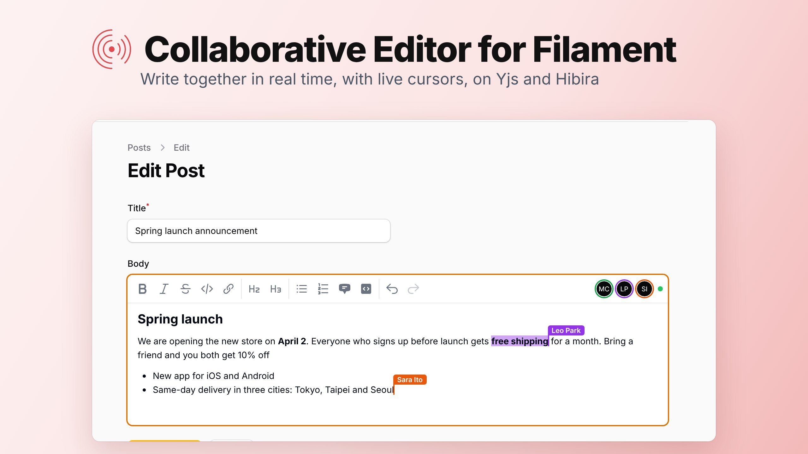
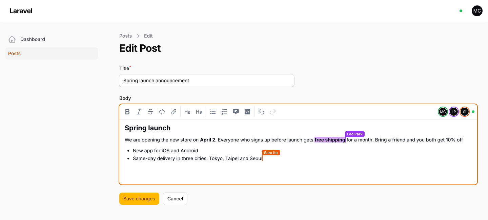
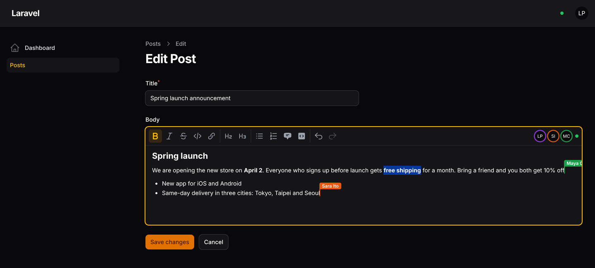

# hibira-io/filament-collab



[](https://github.com/hibira-io/filament-collab/actions/workflows/ci.yml)

A rich text editor for [Filament](https://filamentphp.com) that several
people can type in at the same time, like Google Docs, on
[Hibira](https://hibira.io).

- **Write together**: everyone on the edit page types into the same text.
  Changes merge on their own, with no locks and no "someone else saved this
  record" errors. Built on [Yjs](https://yjs.dev) and
  [TipTap](https://tiptap.dev).
- **Live cursors and selections** with each person's name, and the avatars
  of who is editing.
- **Nothing is lost**: changes are stored in your database as people type.
  Someone who opens the page later, or comes back after losing their
  connection, picks up where everyone is.
- **A normal Filament field**: its state is HTML, like `RichEditor`, and the
  record is saved with your Save button as usual.
- In English, 繁體中文, 简体中文, 日本語, 한국어, ไทย and Tiếng Việt.

Supports Filament 3, 4 and 5.



## Install

```sh
composer require hibira-io/filament-collab
php artisan hibira:install
php artisan migrate
```

`hibira:install` (from [hibira-io/laravel](https://github.com/hibira-io/laravel))
adds the `HIBIRA_*` settings to `.env`. Copy the app ID, key and secret from
your app page on [hibira.io/portal](https://hibira.io/portal) (the free plan
needs no card), and check them with `php artisan hibira:check`.

On the same app page, turn on **Client events**. Cursors travel between
browsers as client events; the text itself does not need them.

Add both plugins to your panel. `HibiraPlugin` from
[hibira-io/filament](https://github.com/hibira-io/filament) connects the
panel to Hibira; `HibiraCollabPlugin` lets the editors in the panel work
together.

```php
use Hibira\Filament\HibiraPlugin;
use Hibira\FilamentCollab\HibiraCollabPlugin;

public function panel(Panel $panel): Panel
{
    return $panel
        // ...
        ->plugins([
            HibiraPlugin::make(),
            HibiraCollabPlugin::make(),
        ]);
}
```

Then use the field in a resource form:

```php
use Hibira\FilamentCollab\Forms\Components\CollaborativeEditor;

CollaborativeEditor::make('body')
    ->placeholder('Write the announcement…')
    ->columnSpanFull(),
```

Open the record's edit page in two browsers, signed in as two users, and
type.



## Options

```php
CollaborativeEditor::make('body')
    // Choose the toolbar: bold, italic, strike, code, link, h2, h3,
    // bulletList, orderedList, blockquote, codeBlock, undo, redo.
    ->toolbarButtons(['bold', 'italic', 'link', 'bulletList', 'undo', 'redo'])
    ->disableToolbarButtons(['codeBlock'])
    ->minHeight('20rem')
    // Turn live editing off for some users or records.
    ->collaborative(fn (Post $record) => ! $record->is_published)
    // Share one document between fields or records yourself.
    ->documentKey(fn (Post $record) => "post-{$record->translation_group}");
```

A disabled field shows the live text and cursors but cannot be changed.
On a create page there is no record yet, so the field is an ordinary editor
until the record exists.

The field's HTML comes from the browser. Clean it before you show it to
other people, for example with Filament's `str($post->body)->sanitizeHtml()`
or a library such as HTML Purifier.

Publish the config to change the limits or the database connection and
table names:

```sh
php artisan vendor:publish --tag=hibira-collab-config
```

| Setting | Default |
| --- | --- |
| `grant_minutes` | 720: how long a user may keep editing after opening the page |
| `max_update_bytes` | 1 MB: the largest change one request may send |
| `compact_after` | 200: stored changes before they are merged into one snapshot |
| `max_event_bytes` | 3500: bigger changes are fetched instead of sent in the event |

## How it uses Hibira

- Each document has a presence channel per panel. Only users who opened the
  record's edit page can join it, so it also shows who is editing.
- The browser sends its changes to your Laravel app, which stores them and
  passes them on to the others over Hibira. The text does not depend on
  client events, and the server always has the latest version.
- Changes that do not fit in one event on your plan (4 KB on Free), such as
  a large paste, are announced without their content, and the other
  browsers fetch them.
- Cursors are sent directly between browsers as client events, at most a
  few times a second.
- When the saved value is changed outside the editor, for example by an
  import, the next person who opens the page starts the document again from
  that value, and open editors reload it.

## Testing

```sh
composer test
```

The browser code is in `resources/js`. After changing it, rebuild the bundle
in `resources/dist` with `npm ci && npm run build`.

## License

MIT
